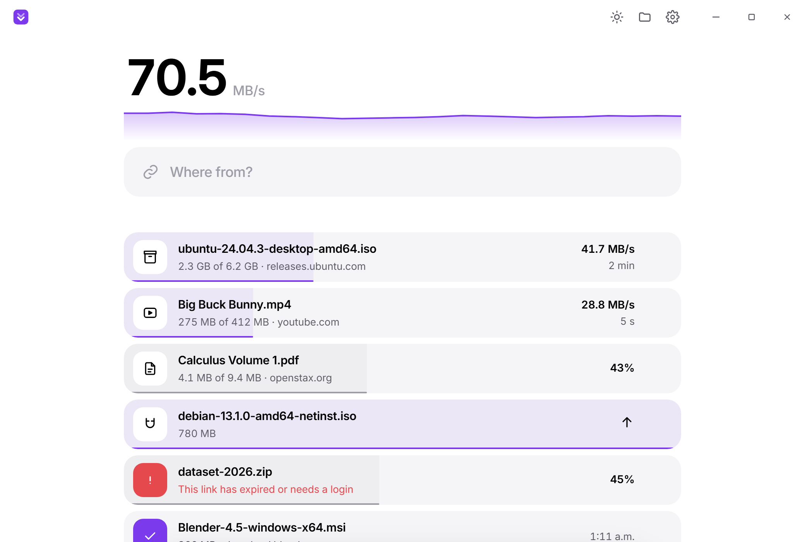
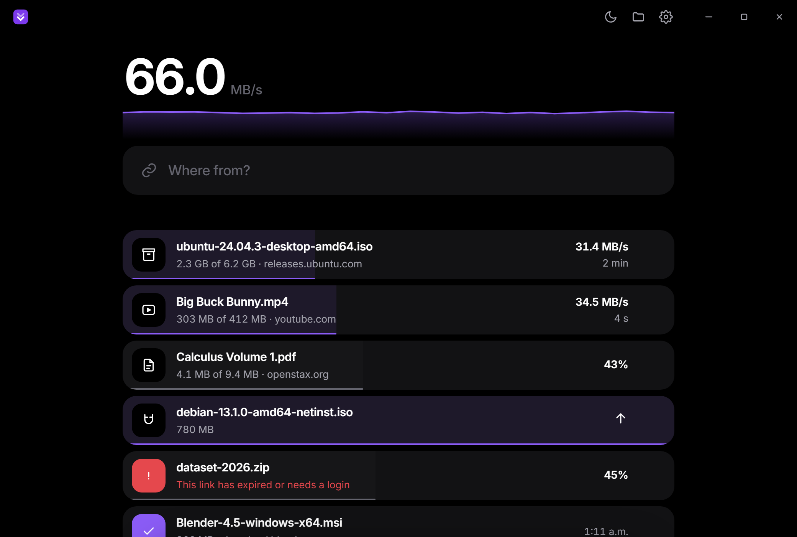

# Dynamic Downloading Dashboard

**Paste a link and get the file faster. Free, open source, and it all runs on your own computer.**

Dynamic Downloading Dashboard (DDD) is a download manager for Windows. Give it a
link to a file, a video page, a stream, a torrent or a page full of links, and
it pulls the file over many connections at once. Most servers cap how fast a
single connection can go, and DDD gets around that cap legitimately by asking
for different parts of the file in parallel.



<details>
<summary>Dark theme</summary>



</details>

---

## The problem

Browsers download a file over one connection. When a server limits each
connection to 2 MB/s, that's all you get, even on a gigabit line. Older download
managers fix that by opening a fixed number of connections and hoping the server
is fine with it, then leave the last slow piece crawling on its own at the end.

DDD finds the right number of connections for each server. It also keeps every
connection busy until the very last byte.

## Features

- **Finds the right number of connections**: it starts with 4, adds more while the speed keeps going up, and stops when it stops helping. If a server pushes back with "busy" or "too many requests", it backs off and remembers that server's limit for next time.
- **No slow finish**: when one connection finishes its part, it takes over half of whatever is left on the slowest one. A connection that falls far behind the others is restarted on a fresh line.
- **Mirrors**: give it several links to the same file and it downloads from all of them at once, leaning on whichever is fastest.
- **Pause and resume**: everything picks up where it stopped, even after a restart or a dropped connection. If a link expires, drop a fresh one on the row and it carries on from the same byte.
- **Videos and streams**: paste a YouTube (or one of 1,000+ other sites) link and pick a quality. Streams (`.m3u8` and `.mpd`) are fetched 16 to 32 pieces at a time, including AES-encrypted ones, and saved as a normal `.mp4`. DRM-protected streams are not supported.
- **Torrents and magnets**: pick which files you want; seeding stops at a ratio you choose. DDD can also be your default app for magnet links.
- **Link grabber**: paste a page or any block of text and every file on it is listed by type, with sizes, ready to tick and download in one go.
- **Copy to catch**: copy a download link anywhere and a small capsule appears by the clock. Click it to start. Nothing else to install.
- **Logins work too**: in your browser's dev tools, right-click the download and pick **Copy as cURL**, then paste it into DDD. The cookies come along, so files behind a login download fine.
- **Safe by default**: files are checked against the server's checksum when it sends one, and marked as downloaded from the internet so Windows still scans them before they run.
- **Stays out of the way**: keeps working from the tray when the window is closed, keeps the PC awake until it's done, and lets you set a speed cap.
- **Light and dark**: follows your system the first time, then remembers your choice.

## Install (Windows 10/11)

**Download page: [ddd-site.vercel.app](https://ddd-site.vercel.app/)**

Grab a build from the download page above or straight from the
[**Releases**](https://github.com/JasimSiddiqui/dynamic-downloading-dashboard/releases/latest) page:

| | What it does |
| --- | --- |
| **[`DynamicDownloadingDashboard-Setup.exe`](https://github.com/JasimSiddiqui/dynamic-downloading-dashboard/releases/latest/download/DynamicDownloadingDashboard-Setup.exe)** (recommended) | Installs for your user only (no admin prompt), adds a shortcut and an uninstall entry. |
| **[`DynamicDownloadingDashboard-Portable.zip`](https://github.com/JasimSiddiqui/dynamic-downloading-dashboard/releases/latest/download/DynamicDownloadingDashboard-Portable.zip)** | Unzip anywhere and run `DynamicDownloadingDashboard.exe`. Nothing is installed. |

**First launch:** the app isn't code-signed yet, so Windows SmartScreen shows
*"Windows protected your PC."* Click **More info → Run anyway**. You only see
this once.

The download is small because video tools aren't bundled. The first time you
save a video, DDD fetches [yt-dlp](https://github.com/yt-dlp/yt-dlp) (about
18 MB) and, if needed, [FFmpeg](https://github.com/yt-dlp/FFmpeg-Builds) (about
90 MB) from their official GitHub releases. It checks both against their
published SHA-256 checksums before using them. If FFmpeg is already on your
PATH, it uses that instead.

## Using it

There's one box. Paste anything into it:

| You paste | What happens |
| --- | --- |
| A link to a file | It starts right away. |
| A video page | You pick a quality, or audio only. |
| A `.m3u8` / `.mpd` stream | You pick a quality if there's more than one. |
| A magnet link or `.torrent` | You pick which files to get. |
| A web page or a block of text | Every file on it is listed so you can tick the ones you want. |
| A "Copy as cURL" command | The file downloads with your browser's cookies. |

Dropping links or `.torrent` files onto the window works too. `Ctrl+V`
anywhere pastes into the box, `Space` pauses the selected download, `Delete`
removes it (with undo), and `Ctrl+,` opens settings.

## Build from source

You'll need [Node.js](https://nodejs.org) 18+, the
[Rust toolchain](https://rustup.rs), and the
[Tauri prerequisites](https://tauri.app/start/prerequisites/) (on Windows: the
**MSVC C++ build tools** and **WebView2**, which Windows 11 already has).

```bash
git clone https://github.com/JasimSiddiqui/dynamic-downloading-dashboard.git
cd dynamic-downloading-dashboard
npm install

# Run in development
npm run dev

# Build an installer
npm run build

# Windows: build, then stage the installer and portable .zip in release-assets\
npm run package
```

To see the speed-up yourself, `npm run bench` starts a local server that limits
each connection to 2 MB/s. Then run the engine against it:

```bash
cargo run --release --manifest-path src-tauri/Cargo.toml --example get -- "http://localhost:8787/file/104857600?rate=2" 16
```

On that test a single connection gets about 1 MB/s and DDD gets about 13 MB/s,
with an identical SHA-256.

## How it works

DDD is a [Tauri 2](https://tauri.app) app: a Rust core wrapped around the
system WebView, with a plain HTML/CSS/JavaScript interface (no framework, no
bundler).

- **The engine** ([`src-tauri/src/engine`](src-tauri/src/engine)) opens the file with
  `Range: bytes=0-` and keeps that first connection streaming instead of throwing
  it away after a size check. Each extra connection is its own HTTP/1.1 stream,
  because servers throttle per connection and HTTP/2 would squeeze them back into
  one. A controller checks the total speed every second and adds connections in
  small batches while each batch still pays off.
- **Splitting** ([`splitter.rs`](src-tauri/src/engine/splitter.rs)) keeps one
  range per connection. A connection that finishes takes over the back half of
  the largest range still in flight, down to a 1 MB minimum. That's what removes
  the slow finish.
- **Disk writes** ([`writer.rs`](src-tauri/src/engine/writer.rs)) go through one
  thread that writes 512 KB blocks straight to their place in a pre-sized file,
  so the network never waits on the disk. Only bytes that are actually on disk
  count when saving resume points.
- **Streams** ([`src-tauri/src/media`](src-tauri/src/media)) read HLS and DASH
  playlists, download the pieces in parallel while keeping their order, decrypt
  AES-128 pieces, and join video and audio with `ffmpeg -c copy` (no re-encoding).
- **Video sites** ask yt-dlp for the list of formats, then download the chosen
  ones with DDD's own engine. yt-dlp only does the download itself as a
  fallback.
- **Torrents** use [librqbit](https://github.com/ikatson/rqbit).
- **Copy to catch** ([`clipboard.rs`](src-tauri/src/clipboard.rs)) gets clipboard
  changes from Windows directly instead of polling. Plain text is ignored, and a
  link only shows the capsule if it really points at a file.

## Tech stack

- **[Tauri 2](https://tauri.app)**: desktop shell (Rust + system WebView)
- **Rust**: [tokio](https://tokio.rs), [reqwest](https://github.com/seanmonstar/reqwest) with rustls, [librqbit](https://github.com/ikatson/rqbit), [m3u8-rs](https://github.com/rutgersc/m3u8-rs), [suppaftp](https://github.com/veeso/suppaftp)
- **[yt-dlp](https://github.com/yt-dlp/yt-dlp)** and **[FFmpeg](https://ffmpeg.org)**: fetched on first use for video sites and stream joining
- **Vanilla HTML/CSS/JS** for the interface, with the [Inter](https://rsms.me/inter/) typeface

## Known limitations

- Live streams can't be saved yet, only finished videos.
- DRM-protected streams (Netflix, Disney+ and similar) are refused.
- There's no browser extension yet. To catch a download that needs your login,
  use Copy as cURL.
- Prebuilt downloads are Windows only for now.

## License

Copyright (C) 2026 Jasim Siddiqui.

Dynamic Downloading Dashboard is free software, released under the **GNU General
Public License v3.0**. You may use, study, share and modify it; if you
distribute a modified version, that version must also be open source under the
GPL. There is no warranty. See [LICENSE](LICENSE) for the full text.

yt-dlp is released under the Unlicense, and the FFmpeg builds DDD fetches are
GPL. Neither is bundled with DDD; both are downloaded from their own projects on
first use. The Inter typeface is under the SIL Open Font License
([`src/fonts/LICENSE-Inter.txt`](src/fonts/LICENSE-Inter.txt)).
